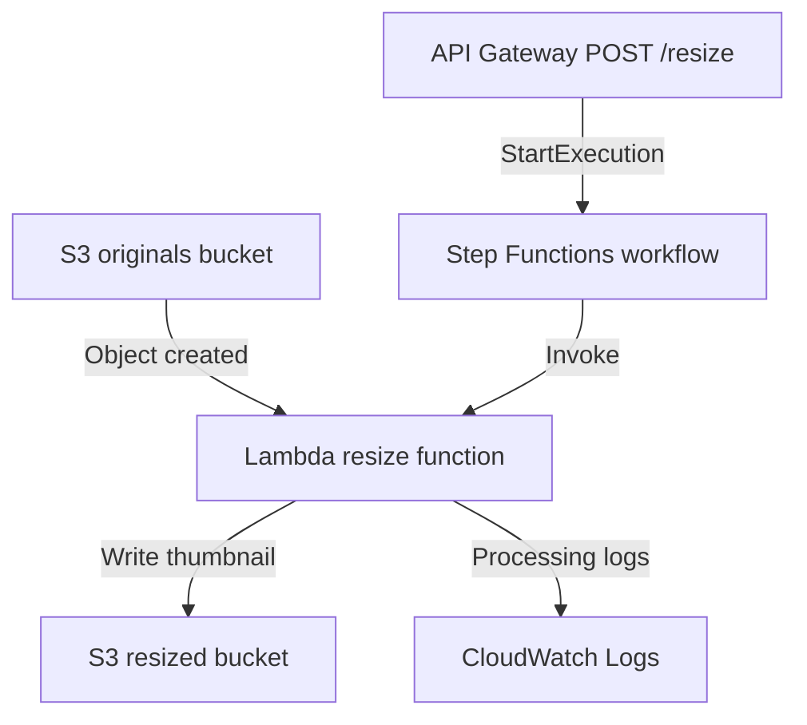

[README.md](https://github.com/user-attachments/files/34773509/README.md)
# BCAA Serverless Image Processing Capstone

Brian DeJesus, Craig Mejorada, and Antoine Meknonnen

This project creates thumbnails from images stored in Amazon S3. Uploading a JPEG, PNG, or WebP to the originals bucket automatically invokes Lambda. You can also send an image key to API Gateway to resize a file already in that bucket. The thumbnail keeps the original format and object key and fits inside 256 × 256 pixels without stretching or enlarging the image.

## Architecture



The Standard workflow invokes Lambda in `ResizeImage`. The `CheckResult` choice checks `Payload.success` and routes to `ResizeSucceeded` or `ResizeFailed`. The task also catches Lambda errors and sends them to `ResizeFailed`.

## Deployed resources

| Resource | Value |
| --- | --- |
| Region | US East (Ohio), `us-east-2` |
| Originals bucket | `bcaa-capstone-original-images` |
| Resized bucket | `bcaa-capstone-resized-images` |
| Lambda function | `bcaa-capstone-resize-image` |
| Pillow layer | `bcaa-capstone-pillow` |
| State machine ARN | `arn:aws:states:us-east-2:148142121599:stateMachine:bcaa-capstone-image-workflow` |
| Deployed API route | `POST https://cicaaxmu00.execute-api.us-east-2.amazonaws.com/capstone/resize` |

## AWS Console setup

You need an AWS account with permission to create the listed resources and their IAM roles. To build the two ZIPs on Windows, use PowerShell with Python and pip.

1. Create the two S3 general purpose buckets in `us-east-2` with **Block all public access** enabled.
2. From the repository root, package the Lambda source and Pillow 12.2.0 layer.

   ```powershell
   Compress-Archive -Path .\src\resize.py -DestinationPath .\bcaa-resize-code.zip -Force
   py -m pip install --platform manylinux2014_x86_64 --python-version 3.12 --only-binary=:all: --target .\python -r .\layer\requirements.txt
   Compress-Archive -Path .\python -DestinationPath .\bcaa-pillow-layer.zip -Force
   ```

3. Create the Lambda function with **Python 3.12**, **x86_64**, **512 MB** memory, and a **30-second** timeout. Upload the code ZIP and set the handler to `resize.handler`. Publish the layer ZIP for Python 3.12 and x86_64, then attach the layer.
4. Set `ORIGINAL_BUCKET` to `bcaa-capstone-original-images` and `RESIZED_BUCKET` to `bcaa-capstone-resized-images`. Give the Lambda execution role CloudWatch Logs access, `s3:GetObject` on the originals bucket's objects, and `s3:PutObject` on the resized bucket's objects. Add an S3 trigger on the originals bucket for **All object create events**.
5. Create a **Standard** state machine using [workflow/resize.asl.json](workflow/resize.asl.json). For another deployment, replace its Lambda ARN with your function ARN. Give the Step Functions execution role permission to invoke that function.
6. Create a **Regional REST API** with `POST /resize`. Use an **AWS service** integration for **Step Functions** in `us-east-2`, with integration method `POST` and action name `StartExecution`. Use an execution role trusted by `apigateway.amazonaws.com` with `states:StartExecution` on this state machine.
7. Set request body passthrough to **Never** and add this `application/json` integration request template. Substitute your state machine ARN when recreating the setup.

   ```velocity
   {
     "input": "$util.escapeJavaScript($input.body).replaceAll("\\'","'")",
     "stateMachineArn": "arn:aws:states:us-east-2:148142121599:stateMachine:bcaa-capstone-image-workflow"
   }
   ```

8. Set the method authorization to **AWS_IAM** and deploy to the `capstone` stage.

## Test the pipeline

### Automatic S3 upload

Upload a fresh JPEG larger than 256 pixels on its longest side to the originals bucket. Refresh the resized bucket and download the object with the same key. In our test, a 4320 × 3240 photo produced a 256 × 192 thumbnail. Lambda logs are available under `/aws/lambda/bcaa-capstone-resize-image` in CloudWatch Logs.

### Deployed API

With `demo.jpg` in the originals bucket, open **AWS CloudShell**. Your AWS identity needs `execute-api:Invoke` for the route. Run the signed request below.

```bash
(
  signing_env="$(aws configure export-credentials --format env)" || exit 1
  eval "$signing_env"
  curl -sS -i --aws-sigv4 'aws:amz:us-east-2:execute-api' \
    --user "$AWS_ACCESS_KEY_ID:$AWS_SECRET_ACCESS_KEY" \
    -H "X-Amz-Security-Token: ${AWS_SESSION_TOKEN:-}" \
    -H 'Content-Type: application/json' \
    --data '{"key":"demo.jpg"}' \
    'https://cicaaxmu00.execute-api.us-east-2.amazonaws.com/capstone/resize'
)
```

A successful request returns HTTP 200 and an `executionArn`. Find that execution in Step Functions and confirm it reached `ResizeSucceeded`. The execution output shows the resized bucket, key, width, and height. To test failure handling, start a workflow execution with `{"key":"missing.jpg"}` and confirm it reaches `ResizeFailed`.
