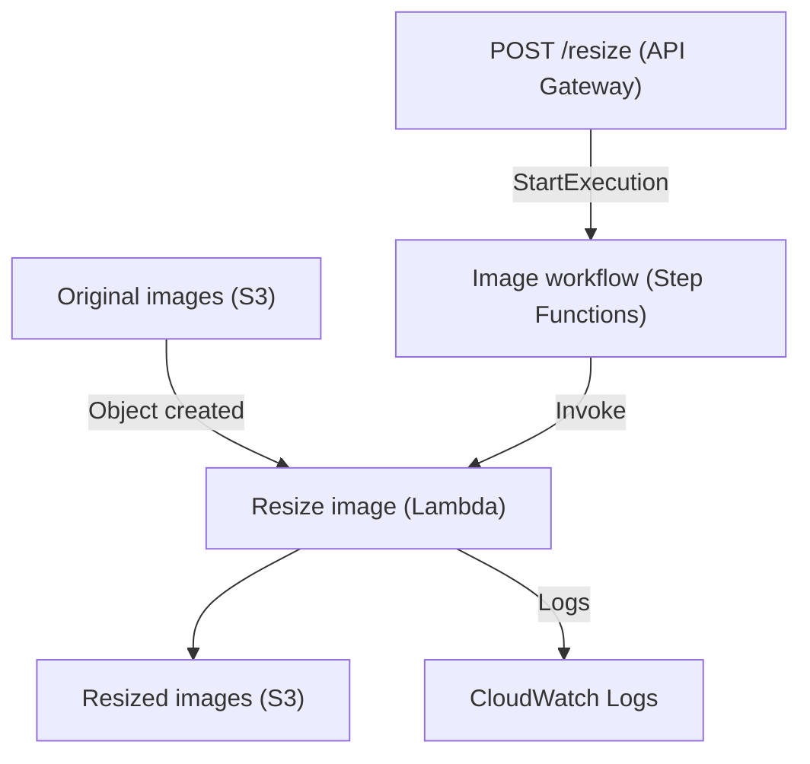

# BCAA Serverless Image Processing Capstone

Brian DeJesus, Craig Mejorada, and Antoine Meknonnen

Upload a JPEG, PNG, or WebP to the originals bucket. S3 calls the resize
Lambda, which fits the image inside 256 × 256 pixels and preserves the
aspect ratio, file format, and object key. Small images stay at their
original dimensions. Both buckets block public access.



The upload calls Lambda directly. The API starts a Standard Step Functions
execution, which calls the same Lambda and branches to success or failure.
The API responds with an execution ARN while the workflow runs.

## Deploy

Install AWS CLI, AWS SAM CLI, and Docker. Start Docker, authenticate the AWS
CLI to the capstone account, and choose a region available to your AWS role.
If your course uses a lab account, confirm it permits CloudFormation to
create the service roles required by the template.

```bash
export AWS_DEFAULT_REGION=us-east-1  # Change this if your lab specifies a region.
aws sts get-caller-identity
sam validate
sam build --use-container
sam deploy --stack-name bcaa-capstone --resolve-s3 --capabilities CAPABILITY_IAM
```

SAM builds the Pillow layer for Python 3.12 on x86-64. The two exact bucket
names must be available in the AWS partition. If a previous deployment
retained either bucket, check its ownership and stack history before
redeploying. Use the CloudFormation outputs for the live API URL and
state machine ARN.

```bash
aws cloudformation describe-stacks --stack-name bcaa-capstone \
  --query 'Stacks[0].Outputs' --output table
```

## Test automatic upload

Choose a JPEG larger than 256 pixels on at least one side.

```bash
aws s3 cp ./demo.jpg s3://bcaa-capstone-original-images/demo.jpg
aws s3 ls s3://bcaa-capstone-resized-images/demo.jpg
aws s3 cp s3://bcaa-capstone-resized-images/demo.jpg ./thumbnail.jpg
```

Allow a few seconds for the event to arrive. Open the downloaded thumbnail
and check that its longest side is 256 pixels and its proportions match the
original. Look for the processing message in `/aws/lambda/bcaa-capstone-resize-image`
in CloudWatch Logs.

## Test API Gateway and Step Functions

The deployed route uses AWS IAM authentication. To test the integration
through the console, open API Gateway, select `bcaa-capstone-image-api`,
then **Resources → /resize → POST → Test**. Send this JSON body with
`Content-Type: application/json`.

```json
{"key":"demo.jpg"}
```

To call the deployed URL, sign the same POST request with SigV4 for the
`execute-api` service in the deployment region, using an AWS principal
with `execute-api:Invoke` on the route. Use the `ResizeApiUrl` stack output.

Copy the returned `executionArn`. Verify the workflow reached
`ResizeSucceeded` and inspect the thumbnail dimensions in its output.

```bash
aws stepfunctions describe-execution --execution-arn '<executionArn>' \
  --query '{Status:status,Output:output,Error:error}' --output json
```

Repeat with a missing key such as `missing.jpg` and verify that the
execution fails. For a clean API demonstration, remove the demo thumbnail
from the output bucket after the upload test and before calling the API.
The API should recreate it from the original.

## Submission

Push the source, workflow definition, template, and README to your team's
GitHub repository. Add the deployed API URL and workflow ARN to the
course submission or private team README. Record a short video showing
the original upload, its thumbnail in the resized bucket, the API test,
and the resulting Step Functions execution.

## Cleanup

Deleting the stack removes the application resources while retaining
the original and resized buckets and their contents. Manage those two
buckets separately when the team has finished with the project.
